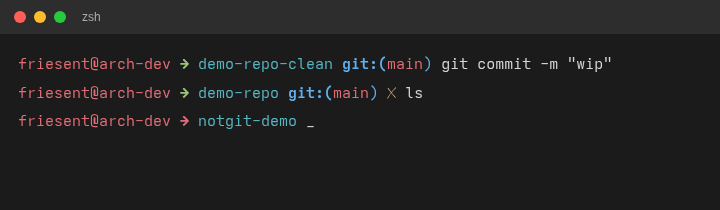

# friesent-zsh

A custom [oh-my-zsh](https://github.com/ohmyzsh/ohmyzsh) prompt theme: username@host, an arrow that turns green or red based on the last command's exit status, the current directory, and git branch/status when inside a repository.



## Install

1. Copy `friesent.zsh-theme` into your oh-my-zsh custom themes directory:

   ```sh
   cp friesent.zsh-theme ~/.oh-my-zsh/custom/themes/friesent.zsh-theme
   ```

2. Set the theme in `~/.zshrc`:

   ```sh
   ZSH_THEME="friesent"
   ```

3. Restart your shell (or `source ~/.zshrc`).

## Font requirement

The prompt uses the Unicode glyphs `➜` (arrow) and `✗` (dirty marker). Most modern terminal fonts render these correctly out of the box; if you see boxes or missing characters, install a font with broad Unicode coverage (e.g. a [Nerd Font](https://www.nerdfonts.com/) or DejaVu Sans Mono) and select it in your terminal emulator.

## License

MIT, see [LICENSE](LICENSE).
